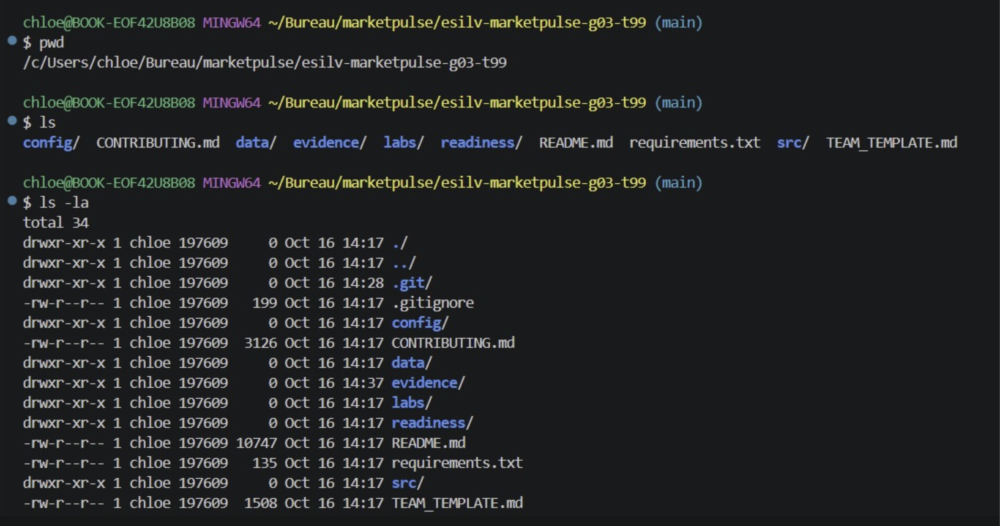
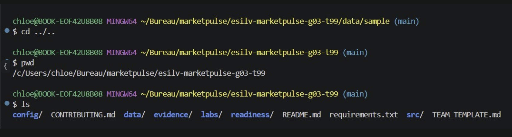
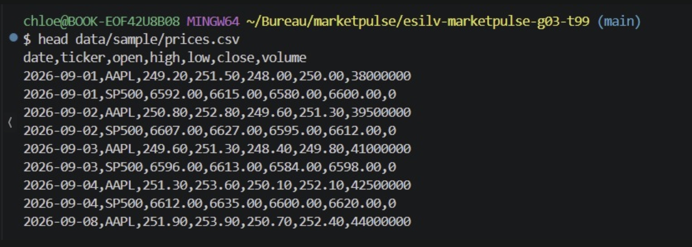
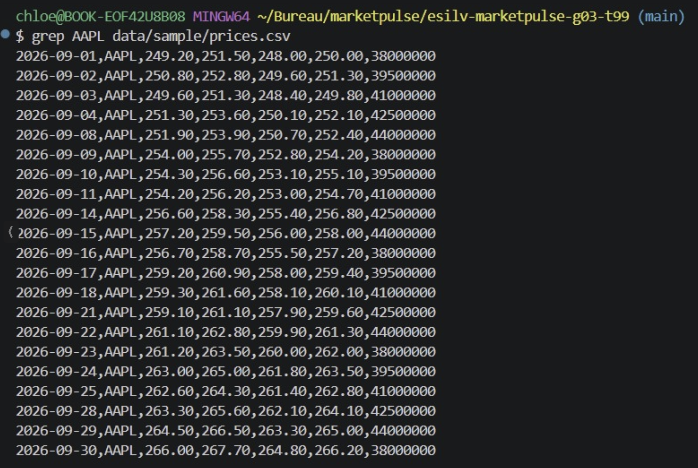
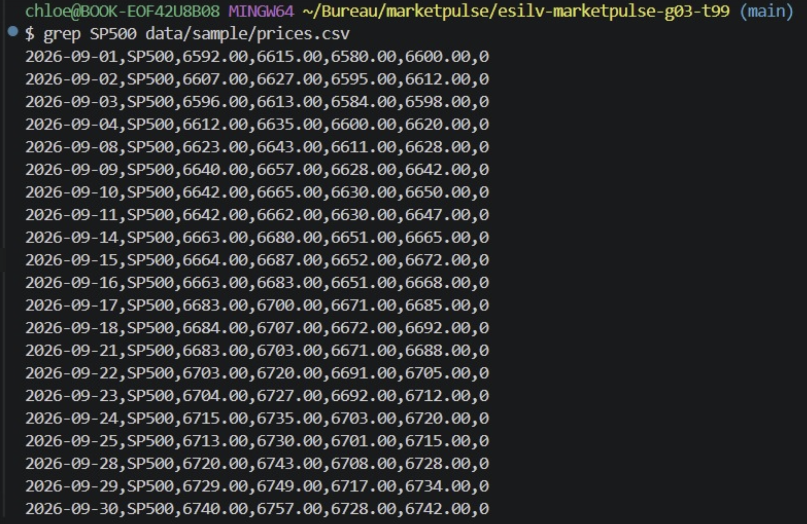
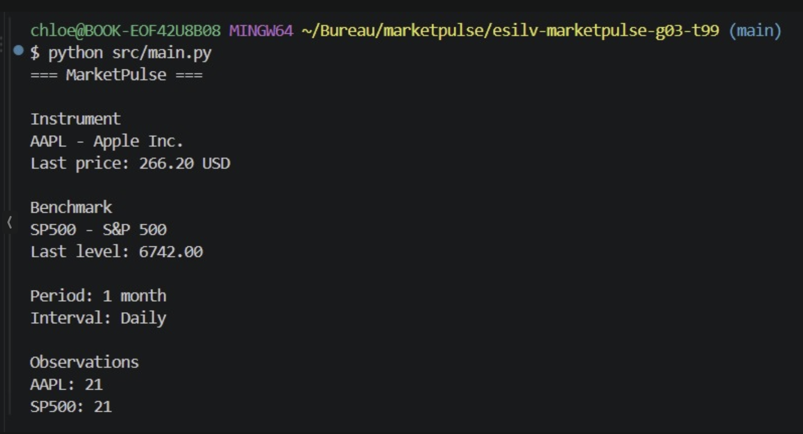

## EVIDENCES FOR TD 1

# pwd, ls, ls -la

# cd, pwd, ls

# cd ../.., pwd, ls

# cat the data 

Instrument: Apple Inc. (AAPL)
Benchmark: S&P 500 (SP500)
Names and tickers: in `data/sample/instruments.json`, under the `name` and `ticker` keys within the `instrument` and `benchmark` objects.

# head the prices

# grep prices AAPL

# grep prices SP500

What we learn:

- The same file contains both time series, Apple and the S&P 500, and `grep` allows us to separate them.
- Each series has 21 rows, one for each trading day in September 2026.
- The header row does not appear because it contains neither “AAPL” nor “SP500”.

# python and git install 

# launch main code 

