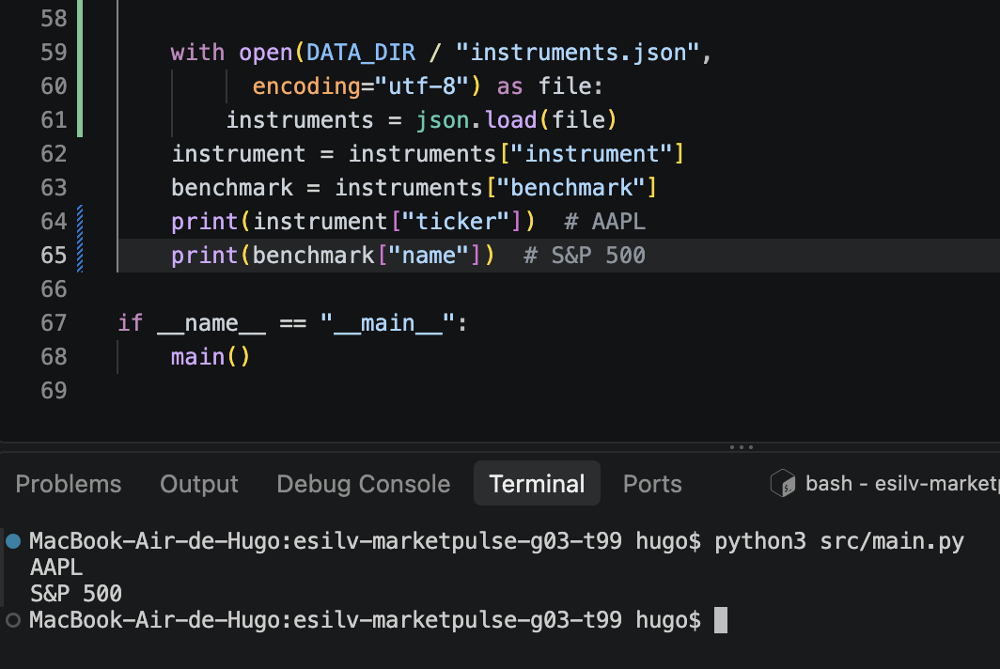
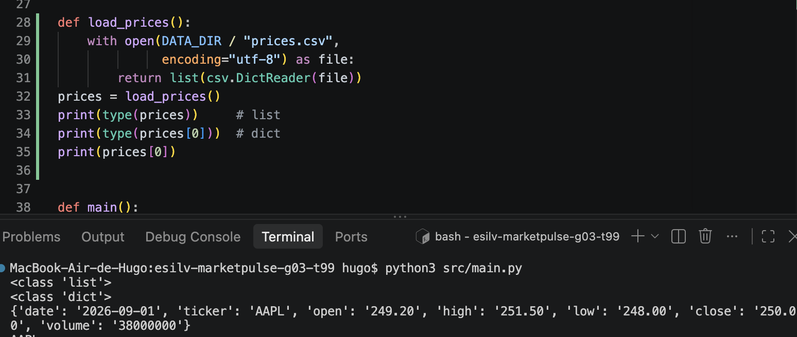
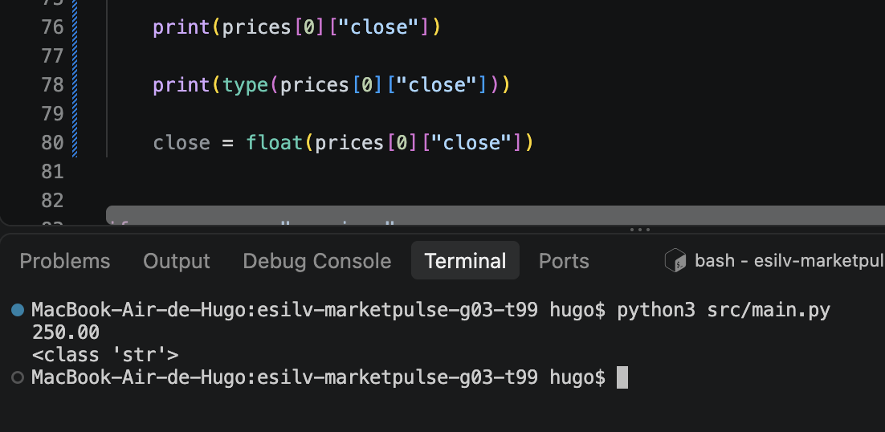
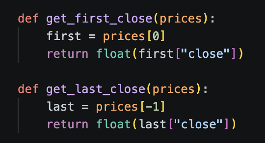
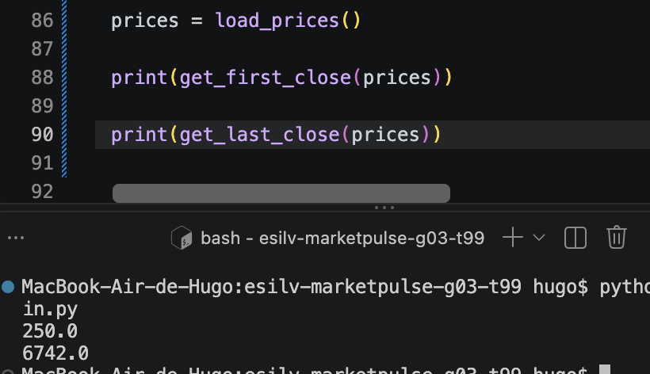
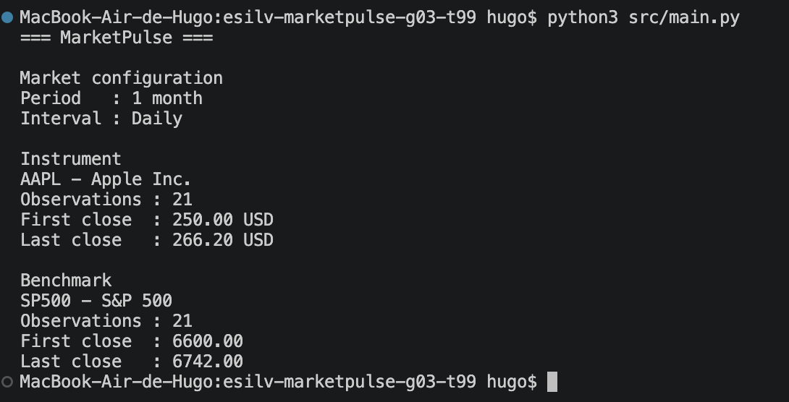

## EVIDENCES FOR TD 2

# 1. Which function reads JSON?

load_instruments()

# 2. Which function reads CSV?

load_prices()

# 3. Which one selects one ticker?

filter_prices()

# 4. Which one coordinates execution?

main()

# 5. Where are the input files stored?

data/sample/

# JSON : 

# CSV : 

# CSV Values : 

# Helpers :

Code :

Calling in main : 

# Final run 

