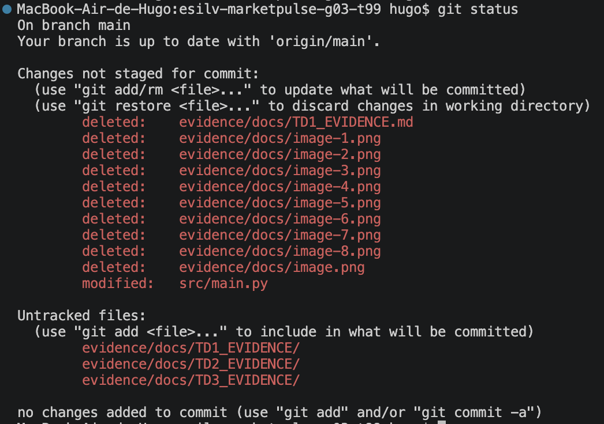
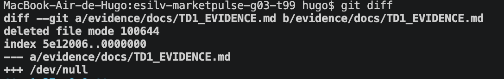
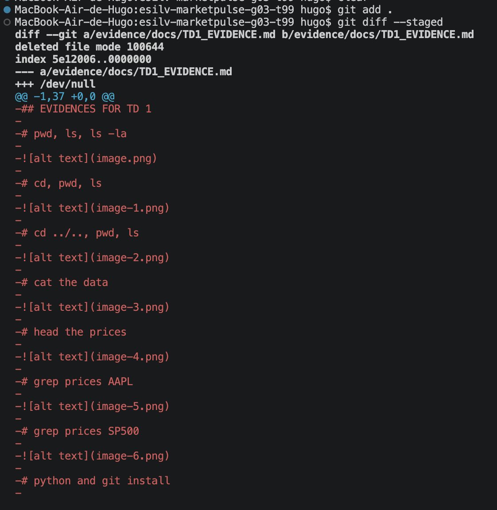
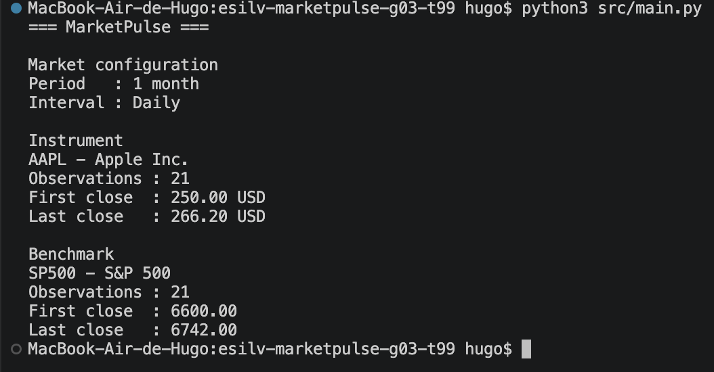
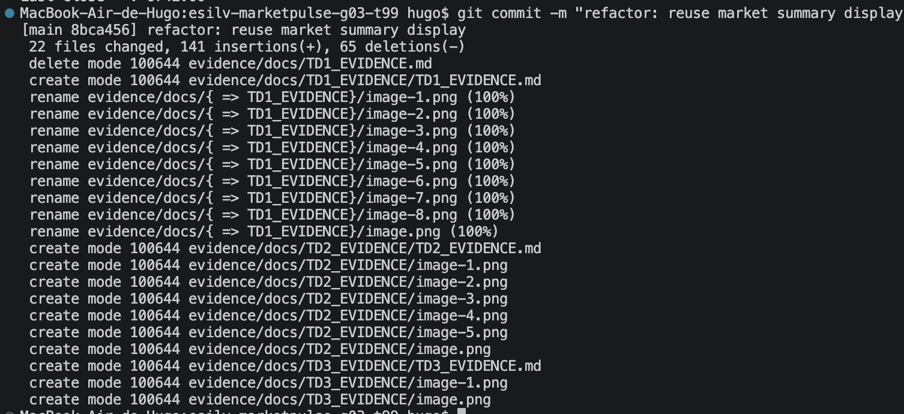
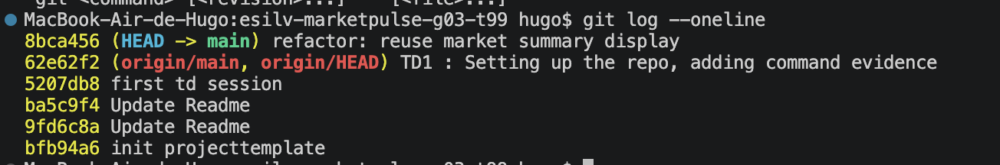
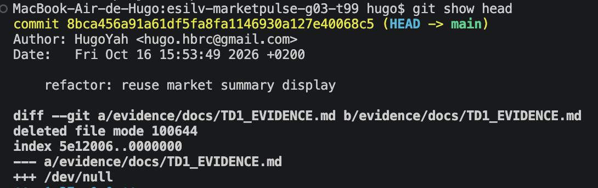

## EVIDENCES FOR TD 3

# Git status

# Git diff

# Git commit etc 
I use git add . here because i know exactly what has been modified.

# main.py still working 

# git commit -m

# git log --oneline and git show HEAD

A lot of files changed : main.py, but also TD1_Evidence, TD2_Evidence, TD3_evidence etc etc
Diff represente what got added(+, in green) or removed (- in red)
The git message is approriate because it follows the convention : it clearly explains what changed, so anyone 
reading the history understands the commit without opening the code unlike vague messages such as "update" or "test"
The author here is me : HugoYahh, hugo.hbrc@gmail.com 
I didn't have to enter config command because I already did them in previous projects

