## EVIDENCES FOR TD4

### Branch Creation : 

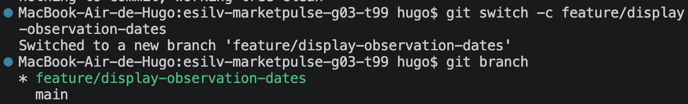

### Display First Date and Last Date

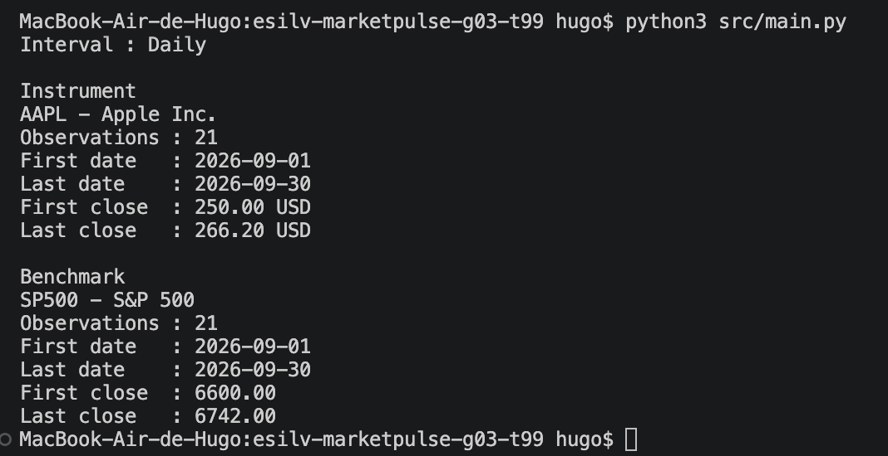

### git Status and diff

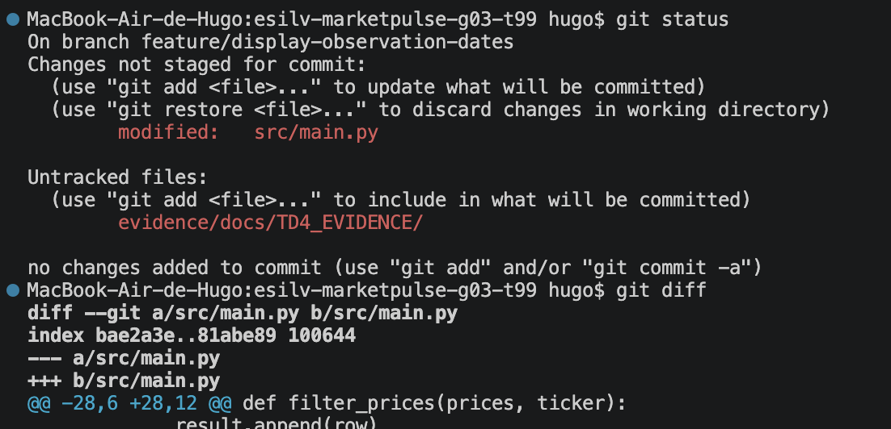

### git add src/main.py and git diff --staged

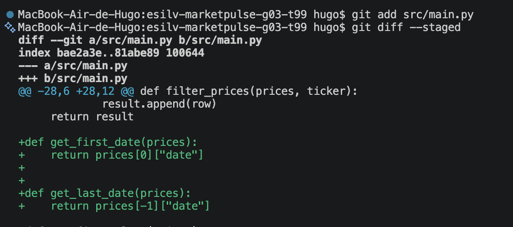

### git commit, and verify with log

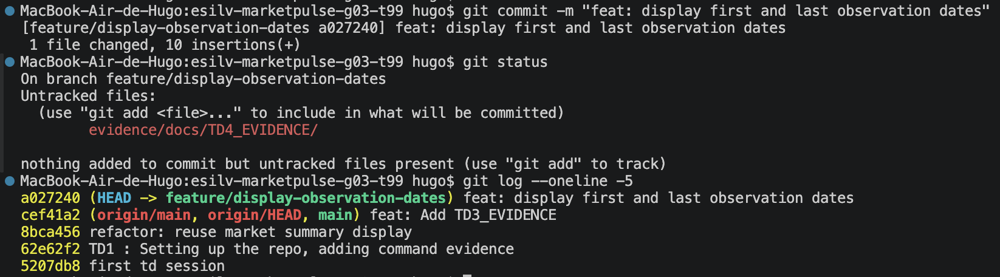

### git log --oneline --graph --decorate --all

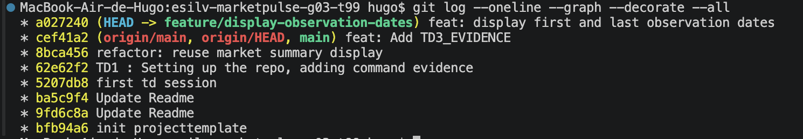
We can see that main is ahead of us, last commit being Add TD3_EVIDENCE
On feature branch, we have the edits of main, and this file TD4_EVIDENCE.md
These changes are not part of main yet since we didn't push to main

### git diff main..feature/display-observation-dates

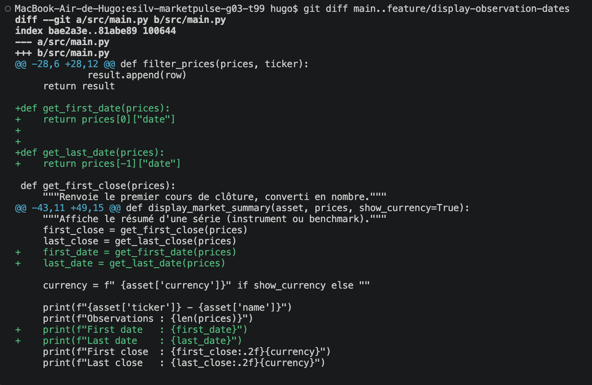

### Merging my branch

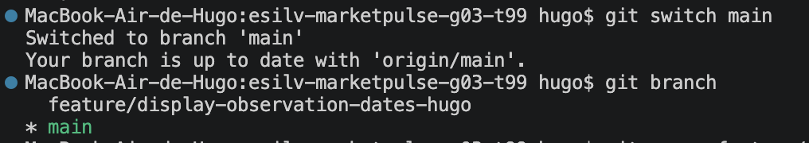
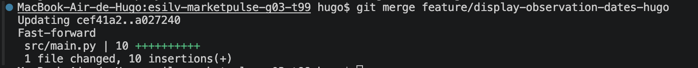

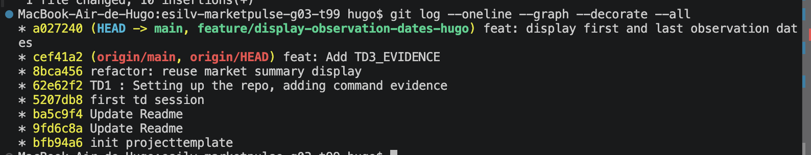

### Is the feature now visible on main ? 

Yes, the local branch aims directly at the commit a027240 which contains the functionnality (HEAD -> main)

### Is the feature commit still visible ?

Yes, commit a027240 appears explicitly on top of the history.

### Did Git perform a fast-forward or create a merge commit?

Git executed a fast-forward. No fusion commit was created, because branch main simply got ahead to the commit of the feature branch 

### What does the graph show?

Graph shows a strictly linear (One vertical line). Both branches point toward the same head commit, which is directly on top of the origin commit 
  
### Evidence of merge 

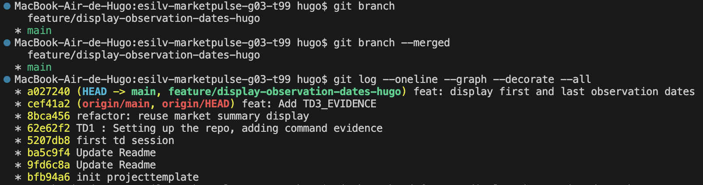

### Deleting the branch

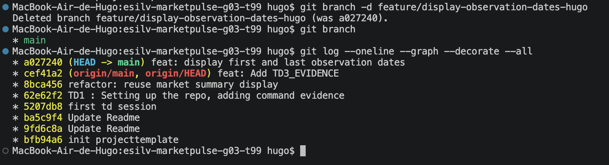
History remains even after deletion

