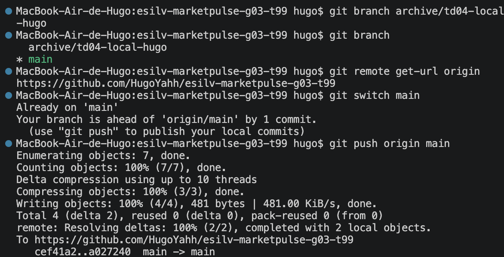
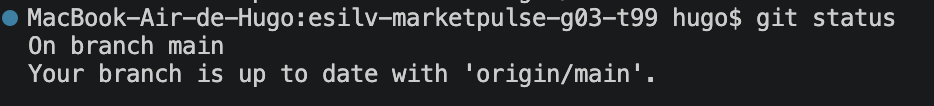
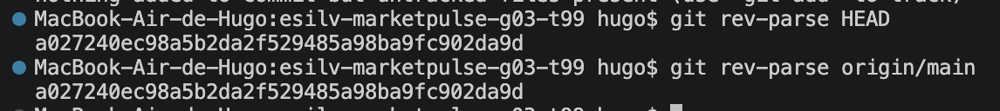
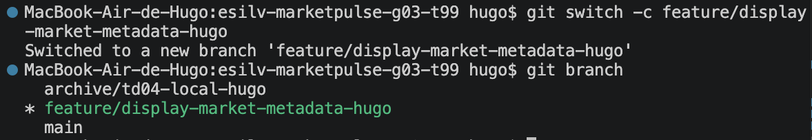
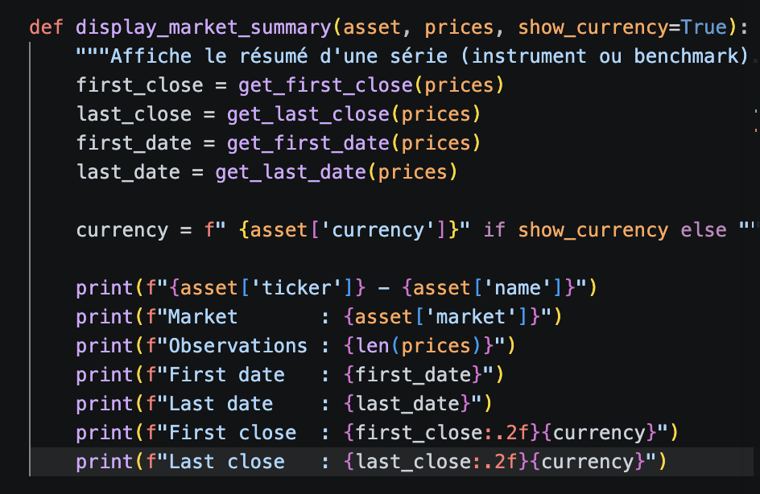
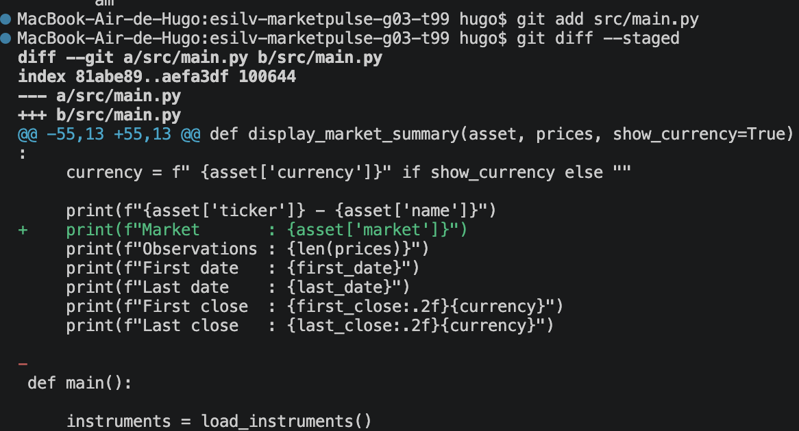
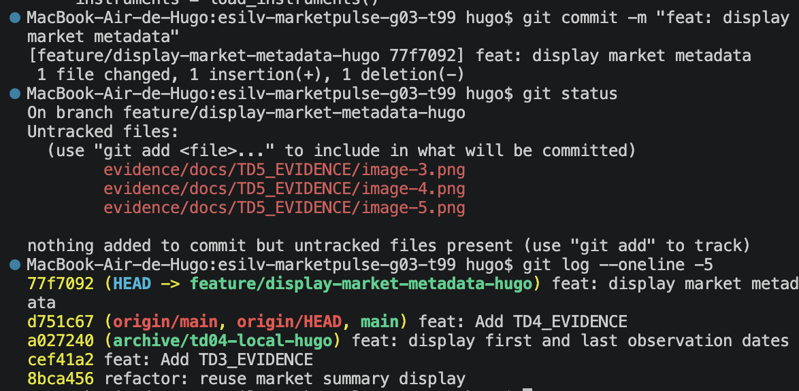
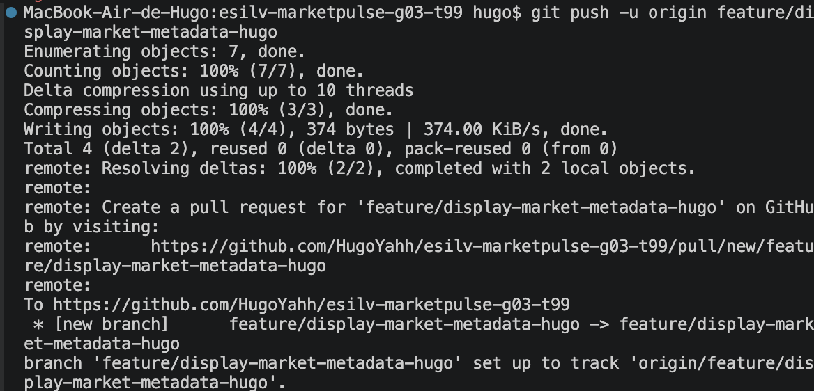
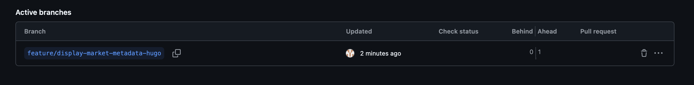
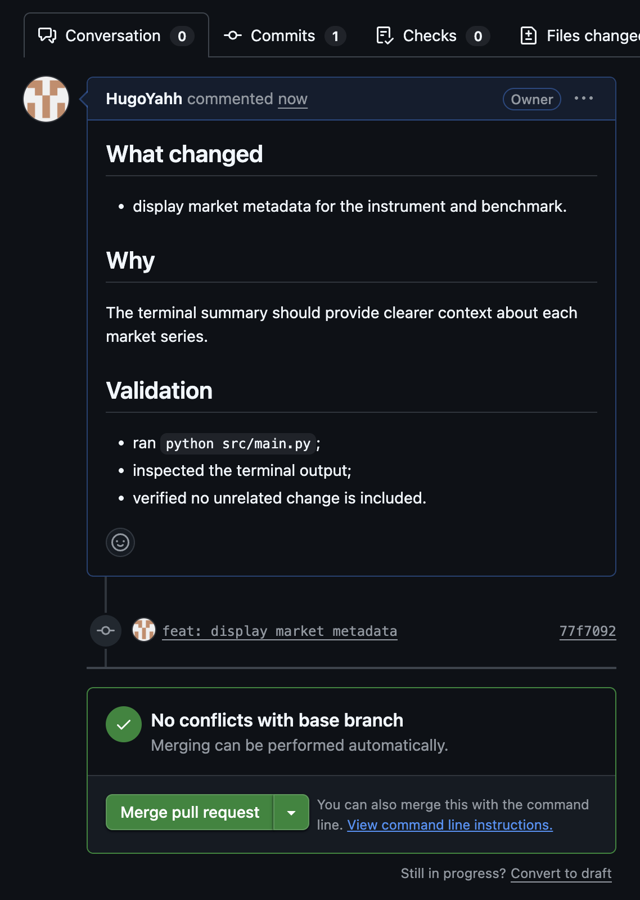

## EVIDENCES FOR TD5

### Pushing to main 

I am now up to date with origin/main

### Both Head and Origin/main have the same commit id

### Creating a branch to work on market metadata

### New market summary function 

### git diff 

### git commit and log

### git push -u origin branch

### we can see the branch on github 

### Creation of a pull request 

